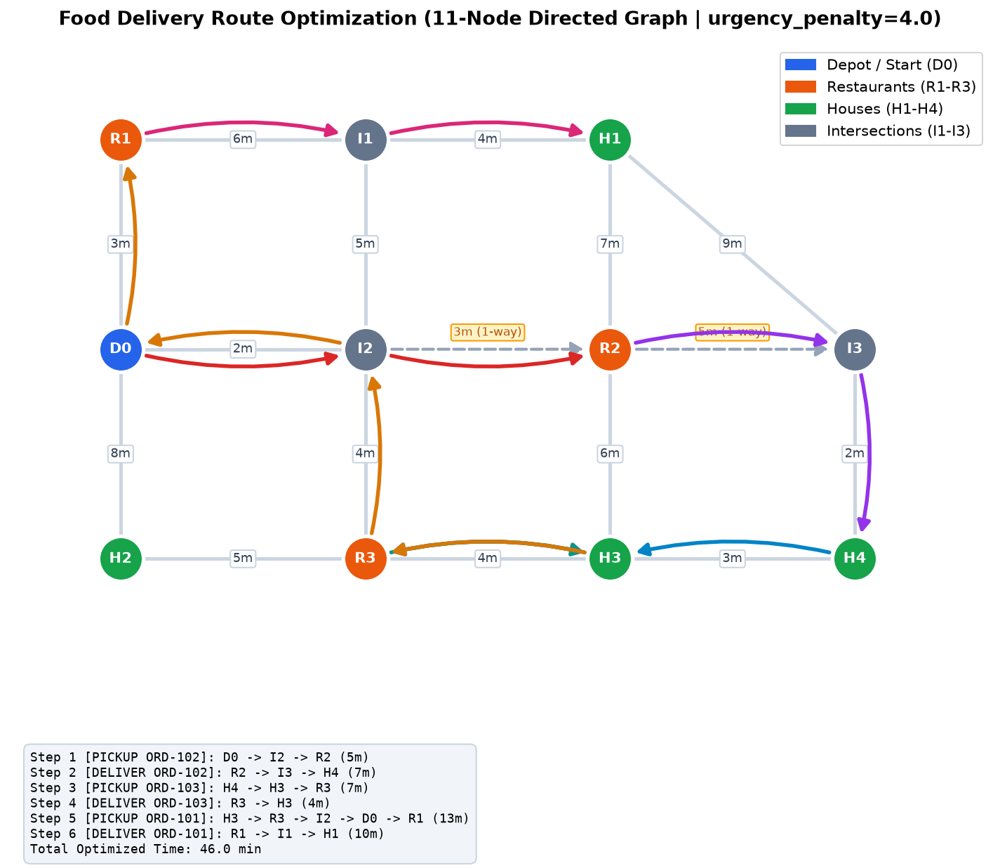

# Food Delivery Route Optimizer

> Multi-order food delivery route optimizer built with custom Graph, Min-Heap Priority Queue, and Hash Map in Python 3.12.

## Overview

This project models a city road network as a **weighted directed graph** to find fast delivery routes for multiple orders. All core data structures (**Graph**, **MinHeap**, and **HashMap**) are written from scratch in pure Python without external graph libraries.

## Features

- **Custom Data Structures (`src/structures/`)** — `Graph` (adjacency list), `MinHeap` (binary min-heap), and `HashMap` (separate chaining with auto-resize).
- **Multi-Order Routing (`src/engine/`)** — Uses Dijkstra's algorithm and a priority queue to pick up orders before delivering them, balancing urgency and travel time.
- **Interactive CLI (`src/main.py`)** — Run the default demo, pass custom orders, check a shortest path, or enter orders interactively.
- **10x10 Random Map Generator (`src/visualization/map_generator.py`)** — Creates connected 100-node random grids with one-way streets and saves sequential `0001_map.png` files.
- **Benchmarks & Charts (`src/benchmark/`, `src/visualization/`)** — Measures $O(\log N)$ and $O((V + E) \log V)$ performance up to 10,000 nodes and exports PNG plots.

## Selected Data Structures

| Structure | Implementation | Role in Project | Time Complexity | Space |
|---|---|---|---|---|
| **Graph** | Adjacency list using `HashMap` | Stores depot (`D0`), restaurants (`R1–R3`), houses (`H1–H4`), intersections, and road times | `add_edge`, `neighbors`: $O(1)$ avg | $O(V + E)$ |
| **Priority Queue** | Array-based `MinHeap` with FIFO tie-breaker | Selects the closest node in Dijkstra and ranks candidate stops in `OrderDispatcher` | `push`, `pop`: $O(\log N)$<br>`peek`: $O(1)$ | $O(N)$ |
| **Hash Map** | Separate chaining table (`load_factor <= 0.75`) | Holds graph edges, node info, Dijkstra distances, and order status by ID | `put`, `get`, `remove`: $O(1)$ avg | $O(N)$ |

**Why these choices?**
- City maps are sparse ($E \ll V^2$), so an adjacency list saves memory compared to an $O(V^2)$ matrix.
- A binary `MinHeap` finds the next closest node in $O(\log V)$ instead of $O(V)$ linear scan.

## Sample City Map (11 Nodes, 30 Directed Edges)

```text
   [R1] ------- 6 ------- (I1) ------- 4 ------- [H1] ------- 9 --------+
    |                      |                      |                     |
    3                      5                      7                     |
    |                      |                      |                     |
   [D0] <====== 2 ======> (I2) ------- 3 ------> [R2] ------- 5 -----> (I3)
    |                      |                      |                     |
    8                      4                      6                     2
    |                      |                      |                     |
   [H2] ------- 5 ------- [R3] ------- 4 ------- [H3] ------- 3 ----- [H4]
```

- **`[D0]`**: Courier depot | **`[R1–R3]`**: Restaurants | **`[H1–H4]`**: Houses | **`(I1–I3)`**: Intersections
- **`--- w --->`**: One-way streets (`I2 -> R2` = 3 min, `R2 -> I3` = 5 min).



## Logarithmic Efficiency Analysis

A binary heap with $N$ items has height $\lfloor \log_2 N \rfloor$, so `push` and `pop` take **$O(\log N)$** time. Using `MinHeap` in Dijkstra gives **$O((V + E) \log V)$** total runtime instead of **$O(V^2)$**.

### Benchmark Results (Docker / Python 3.12.3)

**1. Priority Queue: `MinHeap` $O(\log N)$ vs. `Linear` $O(N)$**

| $N$ | `MinHeap` (ms) | `MinHeap` Avg/Op (µs) | `Linear` (ms) | Speedup |
|---:|---:|---:|---:|---:|
| 100 | 0.434 | 2.170 | 0.393 | 0.91x |
| 500 | 3.435 | 3.435 | 12.862 | 3.74x |
| 1,000 | 11.214 | 5.607 | 54.642 | 4.87x |
| 2,500 | 28.964 | 5.793 | 285.858 | 9.87x |
| 5,000 | 52.349 | 5.235 | 1,242.962 | **23.74x** |

When $N$ grows 10x (`500` to `5,000`), `Linear` slows down by 96.6x, while `MinHeap` per-op time grows only 1.52x (close to $\log_2(5000)/\log_2(500) = 1.37\times$).

**2. Shortest Path: `MinHeap Dijkstra` $O((V+E)\log V)$ vs. `Naive` $O(V^2)$**

| Grid | $V$ | $E$ | `MinHeap` (ms) | `Naive` (ms) | Speedup |
|---|---:|---:|---:|---:|---:|
| 10x10 | 100 | 360 | 1.512 | 0.518 | 0.34x |
| 30x30 | 900 | 3,480 | 22.677 | 34.165 | 1.51x |
| 50x50 | 2,500 | 9,800 | 51.279 | 249.672 | **4.87x** |
| 100x100 | 10,000 | 39,600 | 229.396 | skipped | - |

**3. Hash Map: $O(1)$ Lookup (10,000 Queries)**

| Entries | Buckets | Load Factor | 10k Lookups (ms) | Avg (µs) |
|---:|---:|---:|---:|---:|
| 1,000 | 2,048 | 0.488 | 4.742 | 0.474 |
| 10,000 | 16,384 | 0.610 | 9.681 | 0.968 |
| 50,000 | 131,072 | 0.381 | 7.166 | 0.717 |


## Quick Start

```bash
make build              # Build Docker image (python:3.12.3-slim)
make test               # Run all 11 pytest tests
make run                # Run default multi-order demo
make run-interactive    # Enter custom orders in terminal
make benchmark          # Run efficiency benchmarks
make visualize          # Generate route_map.png & efficiency_analysis.png
make create-map         # Generate random 10x10 map (outputs/0001_map.png, ...)
make clear-maps         # Delete generated NNNN_map.png files
```

### Custom CLI Examples

```bash
docker run --rm food-delivery-router python -m src.main --start D0 --orders "S1:R2:H1:1,S2:R3:H4:2" --penalty 4.0
docker run --rm food-delivery-router python -m src.main --path D0 H4
```

### Sample Output (`make run`)

```text
=== Urgency-Priority Route (SLA) (start=D0, urgency_penalty=4.0) ===
  1. [PICKUP ] ORD-102 | D0 -> I2 -> R2 (5.0 min)
  2. [DELIVER] ORD-102 | R2 -> I3 -> H4 (7.0 min)
  3. [PICKUP ] ORD-103 | H4 -> H3 -> R3 (7.0 min)
  4. [DELIVER] ORD-103 | R3 -> H3 (4.0 min)
  5. [PICKUP ] ORD-101 | H3 -> R3 -> I2 -> D0 -> R1 (13.0 min)
  6. [DELIVER] ORD-101 | R1 -> I1 -> H1 (10.0 min)
  Delivery Order: ORD-102 -> ORD-103 -> ORD-101
  Total Time    : 46.0 min

=== Shortest-Path Route (start=D0, urgency_penalty=0.0) ===
  1. [PICKUP ] ORD-101 | D0 -> R1 (3.0 min)
  2. [PICKUP ] ORD-102 | R1 -> D0 -> I2 -> R2 (8.0 min)
  3. [DELIVER] ORD-102 | R2 -> I3 -> H4 (7.0 min)
  4. [PICKUP ] ORD-103 | H4 -> H3 -> R3 (7.0 min)
  5. [DELIVER] ORD-103 | R3 -> H3 (4.0 min)
  6. [DELIVER] ORD-101 | H3 -> R2 -> H1 (13.0 min)
  Delivery Order: ORD-102 -> ORD-103 -> ORD-101
  Total Time    : 42.0 min
```

## Project Structure

```text
Data_Project/
├── Dockerfile
├── Makefile
├── README.md
├── requirements.txt
├── outputs/            # route_map.png & efficiency_analysis.png
├── src/
│   ├── main.py
│   ├── structures/     # graph.py, hash_map.py, min_heap.py
│   ├── models/         # delivery.py
│   ├── engine/         # city_map.py, dispatcher.py, random_map.py, router.py
│   ├── benchmark/      # analyzer.py
│   └── visualization/  # map_generator.py, plotter.py
└── tests/              # pytest unit & differential tests
```
