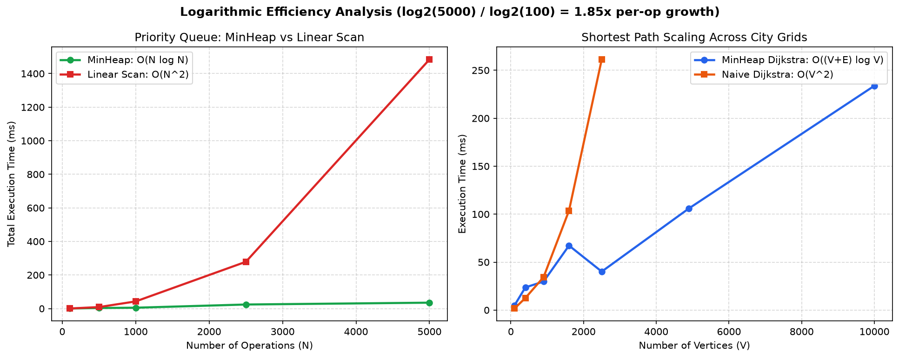

# Food Delivery Route Optimizer

> Multi-order food delivery route optimization engine built with custom Graph, Binary Min-Heap Priority Queue, and Hash Map implementations in Python 3.12.

---

## Overview

This project models an urban road network as a **weighted directed graph** to optimize food delivery routes across multiple restaurants and customer houses. Instead of delegating core logic to external mapping APIs or third-party graph libraries, the prototype implements **HashMap**, **MinHeap**, and **Graph** from scratch in pure Python to demonstrate **$O(1)$ lookup performance**, **$O(\log N)$ priority queue operations**, and **$O((V + E) \log V)$ shortest-path routing**.

## Features

- **Custom Core Data Structures (`src/structures/`)** — Pure Python implementations of `HashMap` (separate chaining + dynamic resizing), `MinHeap` (array-backed binary min-heap), and `Graph` (weighted directed adjacency list).
- **Multi-Order Precedence-Aware Routing (`src/engine/`)** — Combines Dijkstra's algorithm with a priority queue dispatcher so pickups always precede deliveries while balancing SLA urgency against total travel time.
- **Interactive & Parameterized CLI (`src/main.py`)** — Supports default demo runs, one-line custom order testing, direct shortest-path queries, and live interactive order entry.
- **10x10 Random City Map Generator (`src/visualization/map_generator.py`)** — Generates strongly connected 100-node random grids with one-way streets, random depot/restaurant/house placements, and sequential `NNNN_map.png` exports.
- **Empirical Complexity Benchmarks & Plots (`src/benchmark/`, `src/visualization/`)** — Compares $O(\log N)$ and $O((V + E) \log V)$ scaling against naive $O(N)$ and $O(V^2)$ baselines up to 10,000 vertices.

## Tech Stack

| Layer | Technology |
|---|---|
| Language | Python 3.12.3 |
| Core Structures | Pure Python (`HashMap`, `MinHeap`, `Graph`) |
| Visualization | Matplotlib 3.9+ (Headless `Agg` backend) |
| Container | Docker (`python:3.12.3-slim`) |
| Automation | GNU Make |
| Testing | pytest 8.x |

---

## Selected Data Structures & Complexity

| Data Structure | Implementation | Role in System | Time Complexity | Space Complexity |
|---|---|---|---|---|
| **Graph** | Adjacency list backed by `HashMap` | Models intersections, depot (`D0`), restaurants (`R1–R3`), houses (`H1–H4`), two-way roads, and one-way streets | `add_edge`: $O(1)$ avg<br>`neighbors`: $O(1)$ avg | $O(V + E)$ |
| **Priority Queue** | Array-backed Binary `MinHeap` with FIFO sequence tie-breaker | 1) Extracts lowest-distance vertex in Dijkstra<br>2) Ranks candidate pickups/deliveries in `OrderDispatcher` | `push`: $O(\log N)$<br>`pop`: $O(\log N)$<br>`peek`: $O(1)$ | $O(N)$ |
| **Hash Map** | Separate chaining table with dynamic resize (`load_factor <= 0.75`) | Stores graph adjacency lists, vertex metadata, Dijkstra distance/parent tables, and $O(1)$ order state lookup | `put`/`get`/`remove`: $O(1)$ avg | $O(N)$ |

### Why These Choices?

- **Adjacency List vs. Adjacency Matrix:** Urban road networks are sparse ($E \ll V^2$). An adjacency matrix would require $O(V^2)$ space ($100\text{M}$ entries for $V=10{,}000$), whereas an adjacency list uses $O(V + E)$ memory.
- **Binary Min-Heap vs. Unsorted List / Re-sorting:** Choosing the next closest unvisited vertex via linear scan takes $O(V)$ per step ($O(V^2)$ total). A binary min-heap reduces each extract-min and relaxation step to $O(\log V)$, yielding $O((V + E) \log V)$ total runtime.

---

## Sample City Graph Topology (11 Nodes, 30 Directed Edges)

```text
   [R1] ------- 6 ------- (I1) ------- 4 ------- [H1] ------- 9 --------+
    |                      |                      |                     |
    3                      5                      7                     |
    |                      |                      |                     |
   [D0] <====== 2 ======> (I2) ------- 3 ------> [R2] ------- 5 -----> (I3)
    |                      |                      |                     |
    8                      4                      6                     2
    |                      |                      |                     |
   [H2] ------- 5 ------- [R3] ------- 4 ------- [H3] ------- 3 ----- [H4]
```

- **`[D0]`**: Depot / Courier start point (`depot`)
- **`[R1–R3]`**: Restaurants (`restaurant`)
- **`[H1–H4]`**: Customer houses (`house`)
- **`(I1–I3)`**: Road intersections (`intersection`)
- **`--- w --->`**: One-way streets (`I2 -> R2` = 3 min, `R2 -> I3` = 5 min), demonstrating asymmetric routing ($d(\text{D0}, \text{R2}) = 5\text{ min}$ vs. $d(\text{R2}, \text{D0}) = 16\text{ min}$).

### Route Visualization


---

## Analysis of Logarithmic Efficiency

### Theoretical Analysis

1. **Heap Height Bound:** A complete binary tree storing $N$ elements has height $h = \lfloor \log_2 N \rfloor$. Both `_sift_up` (during `push`) and `_sift_down` (during `pop`) traverse at most $h$ levels, bounding each operation strictly to **$O(\log N)$**.
2. **Dijkstra Scaling:** Across $V$ vertices and $E$ directed edges, `dijkstra_all_distances` performs $V$ heap extractions and at most $E$ heap insertions, running in **$O((V + E) \log V)$** time. For sparse grid graphs where $E \approx 4V$, this scales as **$O(V \log V)$** compared to **$O(V^2)$** for naive linear scanning.

### Empirical Benchmark Results (Measured in Docker / Python 3.12.3)

#### 1. Priority Queue: `MinHeap` $O(\log N)$ vs. `Linear` $O(N)$

| $N$ (Items) | $\log_2(N)$ | `MinHeap` Total (ms) | `MinHeap` Avg/Op (µs) | `Linear` Total (ms) | Speedup |
|---:|---:|---:|---:|---:|---:|
| 100 | 6.64 | 0.434 | 2.170 | 0.393 | 0.91x |
| 500 | 8.97 | 3.435 | 3.435 | 12.862 | 3.74x |
| 1,000 | 9.97 | 11.214 | 5.607 | 54.642 | 4.87x |
| 2,500 | 11.29 | 28.964 | 5.793 | 285.858 | 9.87x |
| 5,000 | 12.29 | 52.349 | 5.235 | 1,242.962 | **23.74x** |

*Observation:* When $N$ grows **10x** from `500` to `5,000`, linear total time explodes by **96.6x**, whereas `MinHeap` per-operation cost increases only from `3.435 µs` to `5.235 µs` ($\approx 1.52\times$, closely matching the theoretical $\frac{\log_2(5000)}{\log_2(500)} = 1.37\times$ ratio).

#### 2. Graph Shortest Path: `MinHeap Dijkstra` $O((V+E)\log V)$ vs. `Naive` $O(V^2)$

| Grid | $V$ | $E$ | `MinHeap` (ms) | `Naive` (ms) | Speedup | µs / $(V+E)\log_2 V$ |
|---|---:|---:|---:|---:|---:|---:|
| 10x10 | 100 | 360 | 1.512 | 0.518 | 0.34x | 0.4948 |
| 20x20 | 400 | 1,520 | 9.024 | 8.011 | 0.89x | 0.5437 |
| 30x30 | 900 | 3,480 | 22.677 | 34.165 | 1.51x | 0.5276 |
| 40x40 | 1,600 | 6,240 | 36.927 | 127.430 | 3.45x | 0.4425 |
| 50x50 | 2,500 | 9,800 | 51.279 | 249.672 | **4.87x** | 0.3693 |
| 70x70 | 4,900 | 19,320 | 91.449 | skipped | - | 0.3080 |
| 100x100 | 10,000 | 39,600 | 229.396 | skipped | - | 0.3481 |

*Observation:* Below $V \approx 400$, simple linear scans benefit from lower constant overhead. Past the crossover point, `MinHeap` dominates and solves all shortest paths on a 10,000-node city grid in **229.4 ms**, while normalized cost per $(V + E)\log_2 V$ remains tightly bounded (`0.31–0.54 µs`).

#### 3. Hash Map: $O(1)$ Average Lookup Latency (10,000 Queries)

| Entries | Buckets | Load Factor | 10k Lookups (ms) | Avg/Query (µs) |
|---:|---:|---:|---:|---:|
| 1,000 | 2,048 | 0.488 | 4.742 | 0.474 |
| 10,000 | 16,384 | 0.610 | 9.681 | 0.968 |
| 50,000 | 131,072 | 0.381 | 7.166 | 0.717 |



---

## Quick Start & Usage

### Prerequisites

- Docker
- GNU Make

### Build & Run

```bash
make build              # Build the Docker image (python:3.12.3-slim)
make test               # Run all 11 pytest unit & differential tests
make run                # Run default SLA vs shortest-path multi-order simulation
make run-interactive    # Enter custom courier start & orders interactively
make benchmark          # Run MinHeap, Dijkstra, and HashMap scaling benchmarks
make visualize          # Generate outputs/route_map.png and outputs/efficiency_analysis.png
make create-map         # Generate sequential 10x10 random maps (outputs/0001_map.png, ...)
make clear-maps         # Delete generated NNNN_map.png files after confirmation
```

### Custom CLI Examples

```bash
# Test custom orders in one command
docker run --rm food-delivery-router python -m src.main --start D0 --orders "S1:R2:H1:1,S2:R3:H4:2" --penalty 4.0

# Query shortest Dijkstra path between two nodes
docker run --rm food-delivery-router python -m src.main --path D0 H4
```

### Sample Output (`make run`)

```text
=== Aciliyet Oncelikli Rota (SLA Odakli) (start=D0, urgency_penalty=4.0) ===
  1. [PICKUP ] ORD-102 | D0 -> I2 -> R2 (5.0 dk)
  2. [DELIVER] ORD-102 | R2 -> I3 -> H4 (7.0 dk)
  3. [PICKUP ] ORD-103 | H4 -> H3 -> R3 (7.0 dk)
  4. [DELIVER] ORD-103 | R3 -> H3 (4.0 dk)
  5. [PICKUP ] ORD-101 | H3 -> R3 -> I2 -> D0 -> R1 (13.0 dk)
  6. [DELIVER] ORD-101 | R1 -> I1 -> H1 (10.0 dk)
  Teslim Sirasi : ORD-102 -> ORD-103 -> ORD-101
  Toplam Sure   : 46.0 dakika

=== Saf En Kisa Yol Odakli Rota (start=D0, urgency_penalty=0.0) ===
  1. [PICKUP ] ORD-101 | D0 -> R1 (3.0 dk)
  2. [PICKUP ] ORD-102 | R1 -> D0 -> I2 -> R2 (8.0 dk)
  3. [DELIVER] ORD-102 | R2 -> I3 -> H4 (7.0 dk)
  4. [PICKUP ] ORD-103 | H4 -> H3 -> R3 (7.0 dk)
  5. [DELIVER] ORD-103 | R3 -> H3 (4.0 dk)
  6. [DELIVER] ORD-101 | H3 -> R2 -> H1 (13.0 dk)
  Teslim Sirasi : ORD-102 -> ORD-103 -> ORD-101
  Toplam Sure   : 42.0 dakika
```

---

## Project Structure

```text
Data_Project/
├── Dockerfile
├── Makefile
├── README.md
├── requirements.txt
├── outputs/
│   ├── route_map.png
│   └── efficiency_analysis.png
├── src/
│   ├── main.py
│   ├── structures/
│   │   ├── graph.py
│   │   ├── hash_map.py
│   │   └── min_heap.py
│   ├── models/
│   │   └── delivery.py
│   ├── engine/
│   │   ├── city_map.py
│   │   ├── dispatcher.py
│   │   ├── random_map.py
│   │   └── router.py
│   ├── benchmark/
│   │   └── analyzer.py
│   └── visualization/
│       ├── map_generator.py
│       └── plotter.py
└── tests/
    ├── test_benchmark.py
    ├── test_engine.py
    ├── test_random_map.py
    ├── test_structures.py
    └── test_visualization.py
```
